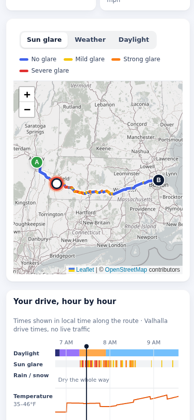
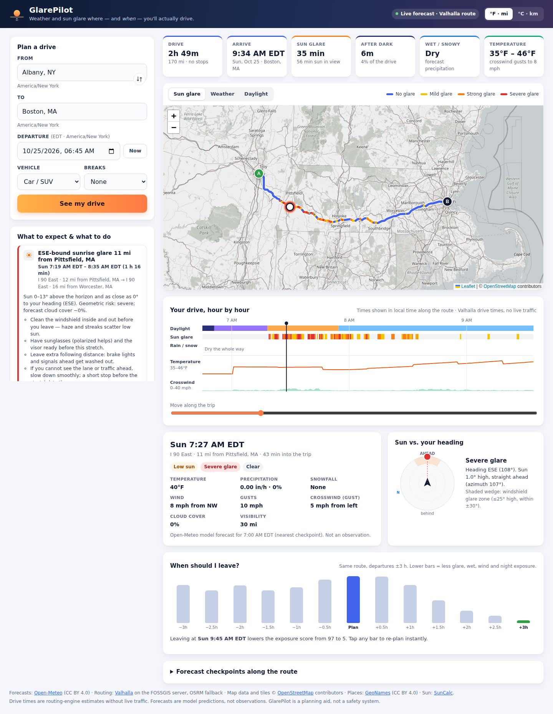

# GlarePilot

Forecast weather and sun glare for the places **and the times** you will actually be on a long US drive.

**Live demo:** https://umass308xiaofanliu.github.io/glarepilot/ — free, no login, no API key.

| Quick link | What it opens |
|---|---|
| [`?preset=chicago-sunset`](https://umass308xiaofanliu.github.io/glarepilot/?preset=chicago-sunset) | Amherst, MA → Chicago, IL tomorrow 8:00 AM EDT, **live** route + forecast |
| [`?snapshot=chicago-sunset`](https://umass308xiaofanliu.github.io/glarepilot/?snapshot=chicago-sunset) | Same trip from a **recorded snapshot** (works if public APIs are down) |

**Demo video:** TODO (human) — paste the public YouTube/Vimeo link here. A captioned screen recording of the live site (under 3 min, no audio) is in [docs/media/glarepilot-demo.mp4](docs/media/glarepilot-demo.mp4).

Hackachusetts 2026 entry. Built with Kiro CLI — see [docs/SUBMISSION.md](docs/SUBMISSION.md).


| Mobile: Albany → Boston sunrise | Desktop full page: Albany → Boston sunrise |
|---|---|
|  |  |

Screenshots were captured from the live site with live data on 2026-10-24 (for departures on 2026-10-25). Live numbers change with each forecast run.

## The problem

Route apps show the weather *now* along the line, and weather apps show a city. Neither tells you whether, on a 14-hour westbound drive, you will reach Ohio just as the sun drops low straight ahead, or whether rain will be at the state line at the hour you get there. Low sun in the driver's eyes is a common, predictable hazard: it depends only on where you are, when, and which way the road points.

## What it does

1. Search a US origin and destination (or pick a demo trip) and enter the departure as wall-clock time **in the origin's time zone**.
2. Route with per-segment routed travel time (Valhalla, OSRM fallback). Optional break plan: none, 15 min every 2 h, or 30 min every 3 h.
3. Resample the route every 1 km with a smoothed heading and compute the arrival time at each sample.
4. Fetch one multi-location hourly forecast for up to 40 checkpoints and pick the value valid **at each sample's arrival time**.
5. Compute sun altitude/azimuth at each sample and time and compare it to the heading: forward glare, low sun behind you, twilight and night.
6. Derive driving implications: rain, heavy rain, snow, ice/freezing precipitation, fog/low visibility, thunderstorms, crosswind and headwind from gusts, cold, darkness and fatigue.
7. Re-evaluate the same route for departures from −3 h to +3 h and suggest a better departure when the difference is meaningful.
8. Show a prioritized briefing where every item says **when, where, why** (the triggering values) and what to do.

UI: KPI strip (drive, arrival, glare, after dark, wet/snowy, temperature), Leaflet map with **Sun glare / Weather / Daylight** layers and legend, SVG hour-by-hour timeline with a scrubber, sun-vs-heading compass, moment card for the selected point, "When should I leave?" optimizer bars, checkpoint table, °F·mi / °C·km toggle, vehicle type (car/SUV, van/truck/RV, motorcycle), loading/error/empty states, and a mobile layout.

## Data you see and where it comes from

| What you see | Kind | Source |
|---|---|---|
| Temperature, precipitation, snowfall, precip. probability, weather code, cloud cover, visibility, wind speed/direction/gusts | **Model forecast** — not observations | Open-Meteo hourly forecast API (`timeformat=unixtime`) |
| Drive time, arrival time at each point, route line, road names | **Routed estimate** — free-flow, no live traffic | Valhalla (FOSSGIS public server); OSRM demo server as fallback. Never a straight-line substitute |
| Sun altitude/azimuth, glare score, rear sun, twilight/night, crosswind/headwind components | **Computed geometry** in the browser | SunCalc + `src/lib/*.js` |
| Place names and time zones in search | Geocoding result | Open-Meteo Geocoding API |
| "near Toledo, OH" labels | Bundled place list | `src/data/us_places.json` (GeoNames) |
| Anything opened via `?snapshot=` or "Open a recorded snapshot" | **Recorded snapshot** of route + forecast, labeled "Recorded snapshot" with capture time | `public/fixtures/*.json`, captured 2026-10-24 ~4:12 PM EDT for departures on 2026-10-25 |

Forecast lookup rules (`src/lib/forecast.js`): instantaneous variables (temperature, cloud, visibility, wind speed) are interpolated between hours; precipitation, snowfall, probability and gusts come from the hour bin ending at or after the arrival time; wind direction and weather code use the nearest hour. Outside the returned forecast window the value is `null` and shown as "no forecast", never filled in. The planner accepts departures up to about 13 days ahead (Open-Meteo serves 16 days including today; GlarePilot keeps a margin so the whole trip, plus the optimizer's ±3 h, stays inside the window).

## How the glare model works

Constants from `src/lib/sun.js`:

- The sun counts as visible when its geometric altitude is above **−0.833°** (upper limb on the horizon).
- Forward glare needs altitude **≤ 25°** (higher sun is usually blocked by the roof/visor) and an angle to the heading of **≤ 30°**.
- `score = lowness × centering`, with `lowness = 1 − max(0, alt)/25` and `centering = 1 − offset/30` (minimum 0.01 inside the cone).
- Severity: **Severe ≥ 0.55**, **Strong ≥ 0.3**, **Mild > 0**, otherwise None.
- Expected glare after the forecast: cloud cover **≥ 85 %**, precipitation ≥ 0.2 mm or visibility < 2 km lowers severity **2 levels**; cloud **≥ 60 %** lowers it **1 level**. Geometric severity is kept and shown alongside.
- Rear sun: visible, altitude ≤ 15° and ≥ 150° from the heading (signals and brake lights look unlit; oncoming drivers face glare).
- Light phase: day > 6°, low sun > −0.833°, twilight > −6°, otherwise night.

```
            sun (alt ≤ 25°)
              \   |   /
         -30°  \  |  /  +30°        score = lowness × centering
                \ | /               lowness   = 1 − alt/25
                 \|/                centering = 1 − |sun az − heading|/30
   ───────────── [car] ──► heading
                  |
       rear cone: ≥150° from heading, alt ≤ 15°
```

SunCalc azimuth (radians from south, positive west) is converted to compass degrees (0 = north, clockwise); headings use the same convention.

## Driving implications and the rules engine

`src/lib/weather.js` turns each forecast value into flags. Crosswind uses the gust (or wind speed) and the meteorological FROM direction: `crosswind = gust × |sin(from − heading)|`. The advisory crosswind limit is **40 mph** for a car/SUV and **25 mph** for a van/truck/RV or motorcycle. Thresholds are planning heuristics, not official criteria.

`src/lib/advice.js` is a **deterministic, explainable rules engine — no LLM or generative AI at runtime**. The same inputs always give the same recommendations. Each one carries the triggering data (sun altitude range, closest angle to heading, cloud cover, snowfall, gusts…) and concrete actions. Rules cover glare windows, rear sun, snow/ice, rain/heavy rain, low visibility, thunderstorms, crosswinds, night driving and dusk arrival, freezing temperatures, fatigue, missing forecast coverage and a departure suggestion.

## Departure optimizer

`src/lib/optimizer.js` re-evaluates the same route (no extra network calls) for departures shifted −180 … +180 min in 30-minute steps. Each candidate gets an exposure score in weighted minutes:

| Condition (per minute) | Weight |
|---|---|
| Severe / strong / mild expected glare | 3 / 2 / 0.5 |
| Snow | 4 |
| Ice | 5 |
| Heavy rain / rain | 2 / 0.75 |
| Thunderstorm | 3 |
| Low visibility | 2 |
| Crosswind above limit | 2 |
| Night | 0.4 |

Candidates in the past, or with more than 5 % of the drive outside the forecast window, are marked unavailable. Among near-ties (within 3 points or 5 % of the best) the smallest shift wins, and a change is suggested only if it saves at least 10 points or 20 %. This is a transparent heuristic for comparing departures, **not a crash-risk model**.

## Architecture

```
place search ─► Open-Meteo Geocoding (name, state, IANA time zone)
route ────────► Valhalla (FOSSGIS) ──fallback──► OSRM demo   (no straight-line fallback)
                coords[], cumDist[], cumTime[] (routed seconds), road names
resample ─────► sample every 1 km: distance, lat/lon, routed driveSec, heading (±300 m)
checkpoints ──► ≤ 40 points (~30 min / 45 km apart) ─► ONE Open-Meteo multi-location request
evaluate(dep) ► per sample: t = dep + driveSec (+ breaks)
                SunCalc → glare / rear sun / phase;  forecast valid at t → hazards, wind
aggregate ────► totals + windows (glare, rear, wet, snow, wind, low vis, night, missing)
optimizer ────► re-evaluate dep −3 h … +3 h → exposure score
rules engine ─► prioritized recommendations: when / where / why / actions
UI ───────────► KPIs · Leaflet map + layers · SVG timeline + scrubber · compass · table
```

Static single-page app: Vite 5 + vanilla ES modules, no backend, no keys. Pure logic in `src/lib/*.js` (no DOM), UI in `src/main.js` and `src/ui/*.js`. All internal times are UTC epoch milliseconds; each point is displayed in its own local zone (the Chicago trip crosses from EDT to CDT).

## Quick start

Requires Node.js and npm.

```bash
npm ci
npm run dev        # Vite dev server on 127.0.0.1
npm run build      # static build in dist/
npm run preview    # serve dist/ on http://127.0.0.1:4173
```

## Tests

```bash
npm test           # 29 node:test unit, integration and fast-check property tests
npm run test:e2e   # 9 puppeteer-core browser scenarios
```

- `tests/unit/math.test.mjs`: time-zone conversion across DST (including the spring-forward gap), compass/bearing helpers, polyline decoding, routed-time resampling, SunCalc azimuth conversion, glare geometry, cloud adjustment, wind components, hazard flags. Property tests (fast-check): wall time → UTC → wall time round trip in 5 US zones, `angleDiff` invariants, glare monotonicity, crosswind ≤ wind speed.
- `tests/unit/pipeline.test.mjs`: forecast hour semantics and `null` outside the window, break timing, window grouping, geocoding, Valhalla → OSRM fallback with no straight-line route, horizon clamping, one multi-point forecast request, snapshot scenarios (Eastern → Central crossing, sunrise glare), optimizer determinism, synthetic snow/wind/night advice.
- `tests/e2e/app.test.mjs`: normal flow, sunrise glare preset, night trip, invalid input, service failures (no route, forecast down, Valhalla down → OSRM), route change and controls, mobile layout, accessibility basics.

E2E runs headless system Chrome (default `/opt/google/chrome/chrome`; override with `CHROME_PATH=/path/to/chrome`) with an isolated temporary profile, a loopback-only Vite preview server, and network requests replayed from the recorded snapshots.

## Recording snapshots

```bash
npm run record:snapshots            # departures tomorrow
npm run record:snapshots 2026-10-25 # departures on a given date
```

Calls the live services for the three presets and writes `public/fixtures/*.json` with `capturedAt`.

## Deploy

```bash
bash scripts/deploy-gh-pages.sh
```

Builds and pushes `dist/` to the `gh-pages` branch (requires push access). The live demo above is served by GitHub Pages. The build uses a relative base, so `dist/` could also be deployed to Cloudflare Pages or any static host; **Cloudflare Pages is not deployed**.

## Built with Kiro

Built in Kiro CLI with steering docs (`.kiro/steering/`), a spec (`.kiro/specs/route-time-weather-glare/`: requirements, design, tasks), fast-check property tests and Kiro subagents for independent review and parallel stages. Full write-up, including what was not used: [docs/SUBMISSION.md](docs/SUBMISSION.md#how-kiro-was-used).

## Limitations

- Routed times are free-flow estimates: no live traffic, construction or stops beyond the optional break plan.
- Weather is model forecast, available about 16 days ahead and less reliable the further out you go.
- The glare model ignores terrain, buildings, trees, road curvature between 1 km samples and windshield/visor geometry.
- Glare, wind and optimizer thresholds and weights are heuristics, not validated safety criteria.
- Public free servers (Valhalla FOSSGIS, OSRM demo, Open-Meteo) can be slow or rate-limited; use a recorded snapshot if they fail. Map tiles follow the OpenStreetMap tile usage policy and are not meant for heavy traffic.
- US only. Web app only: no native app, no PWA/installable app.
- **Not a safety system.** GlarePilot is a planning aid; road signs, official weather alerts and your own judgment take priority.

## Attribution and licenses

Forecasts and geocoding: Open-Meteo (CC BY 4.0). Routing: Valhalla on FOSSGIS servers, OSRM demo server. Map data and tiles © OpenStreetMap contributors (ODbL). Place labels: GeoNames (CC BY 4.0). Bundled libraries: Leaflet (BSD-2-Clause), SunCalc (BSD-2-Clause). Details and full license texts: [THIRD_PARTY_NOTICES.md](THIRD_PARTY_NOTICES.md).

**Project license:** TODO (human) — the author has not chosen a license yet. Until one is added, no open-source license is granted for this repository's own code.

## Team

TODO (human) — add team member names as registered on SundAI.
