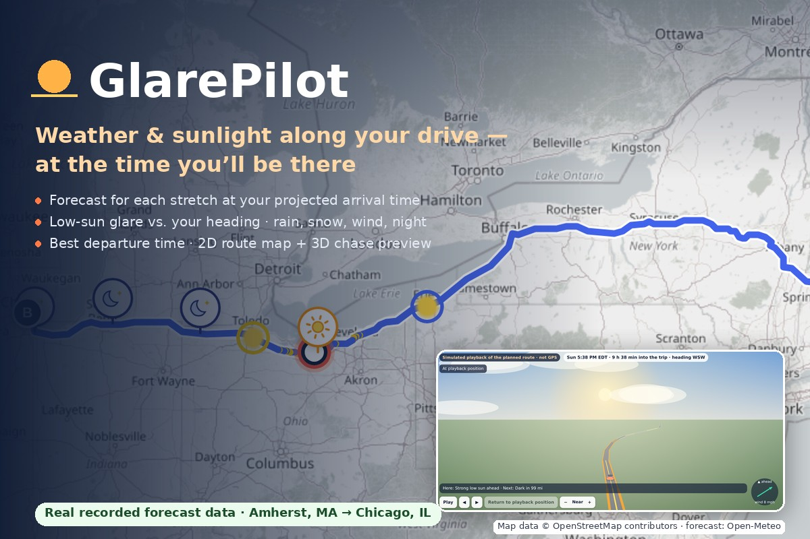
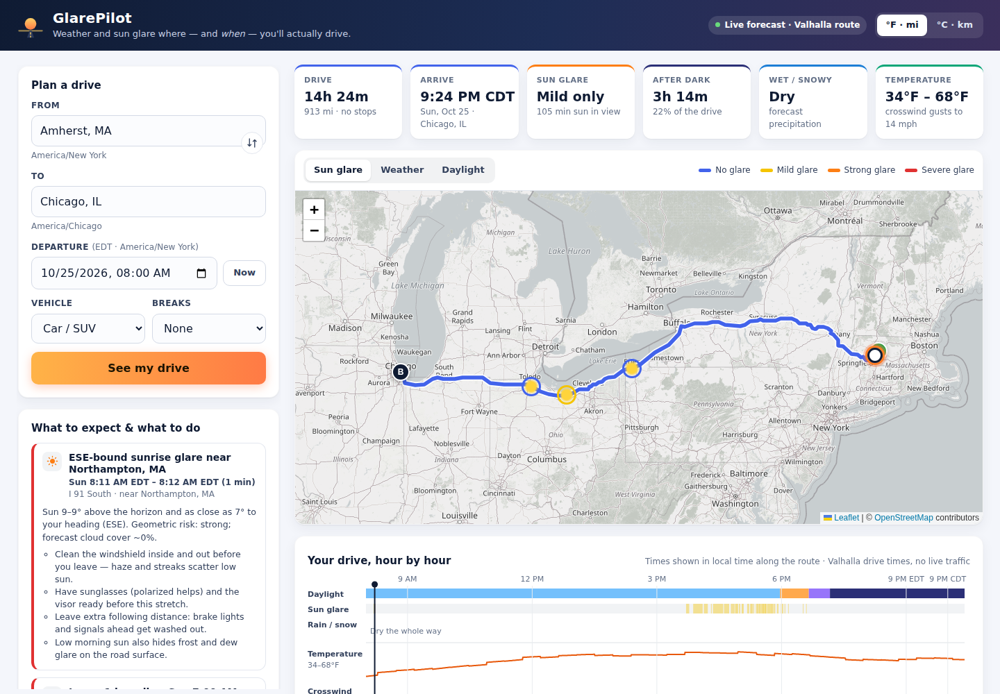
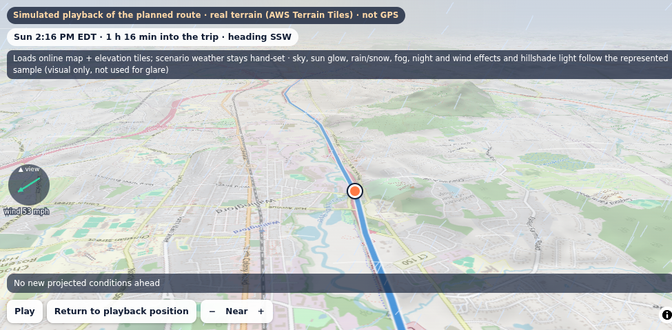
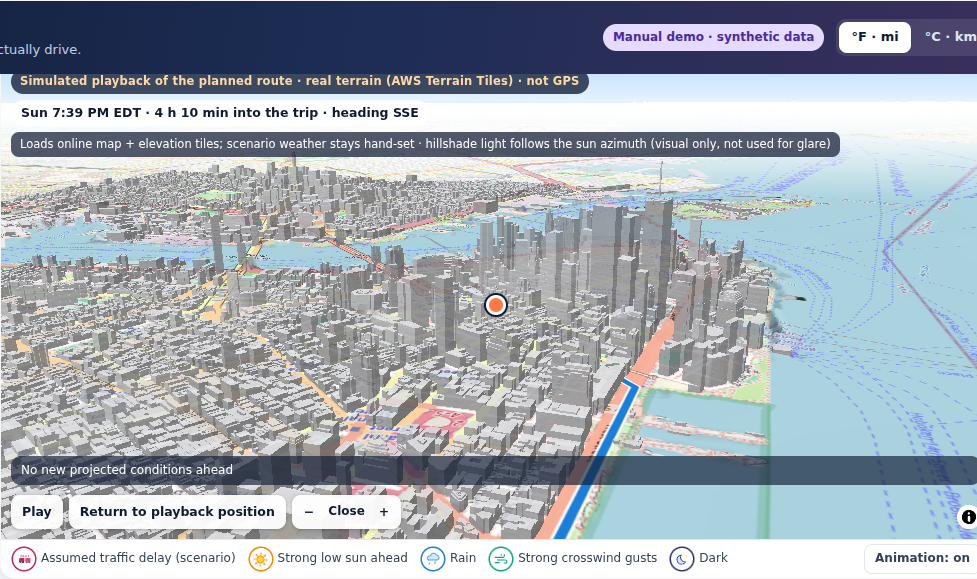

# RouteCast — Weather-Aware Trip Planning

<p align="center">
  <a href="https://youtu.be/o3GfF2jkngo">
    
  </a>
</p>

<p align="center">
  <strong><a href="https://umass308xiaofanliu.github.io/glarepilot/">Open the live app</a></strong>
  · <a href="https://youtu.be/o3GfF2jkngo">Watch the original 2:50 demo on YouTube</a>
  · <a href="https://github.com/Umass308XiaofanLiu/glarepilot/releases/tag/v1.0-hackachusetts">release MP4</a>
  · <a href="docs/media/glarepilot-demo.en.srt">English captions</a>
</p>

RouteCast plans long US drives by time as well as by place. It routes the trip, works out when
you will reach each kilometer of the route, and evaluates the hourly weather forecast and the sun's
position for that place at that time. The result shows where low sun will sit in front of the
windshield, where rain, snow, fog or strong crosswinds are expected, how much of the drive falls
after dark, and whether leaving earlier or later would avoid the worst of it.

It is a static web app with no backend, no account and no API key. Guidance comes from a
deterministic rules engine that reports the values behind every recommendation; no generative AI
runs in the app. The project was built with Kiro CLI for Hackachusetts 2026 under the name
GlarePilot; the repository address and the live URL keep that name.

The live site runs **v1.1.1**. The build submitted to Hackachusetts is preserved as
[`v1.0-hackachusetts`](https://github.com/Umass308XiaofanLiu/glarepilot/releases/tag/v1.0-hackachusetts).
The demo video was recorded from that original GlarePilot build and uses a synthetic
text-to-speech voice. Features added in v1.1 are therefore not shown in it: the 3D terrain view,
the terrain check, location follow and the traffic overlays. The screenshots below also predate
the rename.

## Data modes

| Mode | What runs | Network |
|---|---|---|
| **Real-data planning** | A live Valhalla route (OSRM fallback) and an Open-Meteo forecast are retrieved when you plan. Each point uses the forecast for its projected arrival time, not current conditions. | Open-Meteo, Valhalla/OSRM, map tiles |
| **Recorded snapshot** | Route and forecast captured on 2026-10-24 for three trips, labeled with the capture time. Useful when the public services are slow or down. | Map tiles only |
| **Manual demo scenario** | Hand-set synthetic weather and delays on a recorded real route, labeled "Manual demo · synthetic data". Each scenario shows one feature reproducibly. | Map tiles only |

In every mode, the 3D terrain view also loads elevation and building tiles, and the terrain check loads elevation tiles.

| Link | Opens |
|---|---|
| [`?preset=chicago-sunset`](https://umass308xiaofanliu.github.io/glarepilot/?preset=chicago-sunset) | Live plan: Amherst, MA → Chicago, IL, tomorrow at 8:00 AM Eastern |
| [`?snapshot=chicago-sunset`](https://umass308xiaofanliu.github.io/glarepilot/?snapshot=chicago-sunset) | The same trip from a recorded snapshot |
| [`?demo=sunset-glare&view=3d`](https://umass308xiaofanliu.github.io/glarepilot/?demo=sunset-glare&view=3d) | Westbound low sun near Lake Erie, in the 3D chase preview |
| [`?demo=congestion-shift`](https://umass308xiaofanliu.github.io/glarepilot/?demo=congestion-shift) | An assumed 75-minute delay pushes the New York arrival into rain and darkness |
| [`?demo=storm-crosswind&view=terrain`](https://umass308xiaofanliu.github.io/glarepilot/?demo=storm-crosswind&view=terrain) | Heavy rain and crosswind gusts in the 3D terrain view (requires WebGL) |
| [`?demo=congestion-shift&view=terrain`](https://umass308xiaofanliu.github.io/glarepilot/?demo=congestion-shift&view=terrain) | Terrain and 3D buildings: move the timeline to New York and choose the Close camera |

Other snapshots: `boston-sunrise`, `nyc-evening`. Other demo scenario: `snow-fog-night`.



| 3D terrain view, synthetic storm | 3D buildings at the New York end, Close camera |
|---|---|
|  |  |

## Features

- **Route-time evaluation.** You enter the departure as local time at the origin. The route is
  resampled every 1 km with a smoothed heading, and each sample gets its arrival time. Arrival
  times include optional breaks and an optional assumed delay. Up to 40 checkpoints share one
  Open-Meteo request, and each sample takes the forecast value valid at its arrival time.
- **Sun glare.** SunCalc gives the sun's position at each sample and time, and RouteCast compares
  it with the road heading. The model scores low sun ahead, then lowers the expected severity when
  cloud, precipitation or poor visibility is forecast. Low sun behind the car, twilight and night
  are reported separately.
- **Driving conditions.** Rain, heavy rain, snow, ice, fog and low visibility, and thunderstorms
  come from the forecast. Crosswind and headwind are computed from the forecast gusts, with limits
  that depend on the vehicle type. Cold, darkness and fatigue are also flagged.
- **Briefing.** A prioritized list of recommendations. Each one states when and where it applies,
  the values that triggered it, and what to do.
- **Departure comparison.** The same route is re-evaluated for departures from 3 hours earlier to
  3 hours later, in 30-minute steps. A transparent exposure score marks the best option, and
  RouteCast suggests a change only when it is meaningfully better.
- **Views.**
  - The *2D map* (Leaflet) has sun-glare, weather and daylight layers and animated condition icons.
  - The *3D chase preview* (Canvas) shows the road from behind and above the car.
  - The *3D terrain view* (MapLibre GL, WebGL) shows terrain and buildings, with weather, light and
    wind effects drawn from the selected point.
  - All three views share the timeline, playback, look-ahead and camera controls. The 3D views
    simulate playback of the planned route; they are not GPS navigation.
- **Terrain check** (v1.1). This optional check tests whether hills are likely to hide the low sun
  along a glare window. It uses bare-earth elevation at about 30 m and reports a separate
  terrain-adjusted glare figure. The main glare score is not changed.
  See [docs/OCCLUSION.md](docs/OCCLUSION.md).
- **Location follow** (v1.1). Optionally, your browser location moves the playback position along
  the planned route. It includes jitter protection and an accuracy circle. Coordinates stay in the
  tab and are never stored or sent.
- **Units, accessibility, mobile.** °F/mi and °C/km, keyboard controls, reduced-motion support and
  a responsive layout.

## Traffic and timing

The public Valhalla and OSRM servers return free-flow travel times, and RouteCast does not predict
traffic. Instead you can state a delay of 15 minutes to 2 hours, spread over the whole trip or one
stretch of it. Every later point is then re-timed against the forecast and the sun, and a summary
card shows what the delay changes.

After a real-data plan, two keyless public feeds can be checked on demand where they apply:

- NYC DOT real-time speeds, only for departures within the next hour;
- INDOT work-zone reports.

Both appear as overlays and never change the timing automatically. This is regional coverage, not
nationwide or predictive traffic.

Routing through TomTom, HERE or Mapbox with your own key is experimental. It appears only with
`?experimental=traffic` and has been tested against mocked responses only.
See [docs/TRAFFIC.md](docs/TRAFFIC.md).

## How it works

```text
origin, destination, local departure time
  → Open-Meteo geocoding (place and IANA time zone)
  → Valhalla route with per-segment travel times (OSRM fallback; never a straight line)
  → 1 km samples: position, heading, drive time (+ breaks, + assumed delay)
  → ≤ 40 checkpoints → one multi-location Open-Meteo hourly request
  → per sample at its arrival time: forecast value, sun position, glare, wind components
  → windows and totals → rules engine and departure comparison (−3 h … +3 h)
  → KPIs, 2D map, 3D views, timeline, checkpoint table
```

The core logic in `src/lib/` is pure JavaScript with no DOM access; the UI lives in `src/main.js`
and `src/ui/`. All times are handled internally as UTC and shown in each point's local time zone,
so the Chicago trip crosses from EDT to CDT.

Forecast values follow strict rules:

- Instantaneous values (temperature, cloud, visibility, wind speed) are interpolated between hours.
- Precipitation, probability and gusts come from the hour that contains the arrival.
- Times outside the forecast window show as "no forecast" and are never filled in.

Departures can be planned up to about 13 days ahead.

Main constants in the glare model ([`src/lib/sun.js`](src/lib/sun.js)):

- **Forward glare.** The sun must be above the horizon (altitude above −0.833°), no more than 25°
  high and within 30° of the heading. The score is `lowness × centering`. Severity is Severe at
  0.55 or above, Strong at 0.3 or above, and Mild above 0.
- **Weather adjustment.** Cloud cover of 85 % or more, precipitation of at least 0.2 mm, or
  visibility under 2 km lowers the expected severity by two levels. Cloud cover of 60 % or more
  lowers it by one level. The geometric value is shown alongside.
- **Crosswind.** Computed as `gust × |sin(wind direction − heading)|`. The advisory limit is
  40 mph for cars and SUVs, and 25 mph for vans, trucks, RVs and motorcycles.

Departure weights and thresholds are in [`src/lib/optimizer.js`](src/lib/optimizer.js) and
[`src/lib/weather.js`](src/lib/weather.js). They are planning heuristics, not validated safety
criteria. More detail, including the module map, the network inventory per mode and the storage
keys, is in [docs/ARCHITECTURE.md](docs/ARCHITECTURE.md).

## Quick start

Requires Node.js and npm.

```bash
npm ci
npm run dev        # Vite dev server on 127.0.0.1
npm run build      # static build in dist/
npm run preview    # serve dist/ on http://127.0.0.1:4173
```

To refresh the recorded snapshots (this calls the live services and writes `public/fixtures/*.json`):

```bash
npm run record:snapshots            # departures tomorrow
npm run record:snapshots 2026-10-25 # departures on a given date
```

The build uses a relative base path, so `dist/` runs on any static host.
`bash scripts/deploy-gh-pages.sh` publishes it to the `gh-pages` branch, which serves the live
demo.

## Verification

```bash
npm test             # unit, integration and fast-check property tests
npm run test:e2e     # browser scenarios in headless Chrome
npm run test:visual  # 3D view screenshots: headed Chrome + SwiftShader under Xvfb
```

Results for v1.1.0:

- **Unit and property tests:** 122/122 passed.
- **Browser scenarios:** 37/37 passed.
- **3D visual checks:** 14/14 passed.

The browser tests run against a local production build, with routing, forecast and geocoding
responses replayed from recorded fixtures. They cover normal planning, glare and night trips,
invalid input, service failures and fallbacks, demo modes, delays, overlays, emulated
geolocation, the terrain check and view switching. After deployment, the live site was checked in
2D, the 3D chase preview, the 3D terrain view (desktop and mobile) and 3D buildings, with a recorded
snapshot and a live plan; no page errors occurred.

Requirements and known issues are in [docs/TESTING.md](docs/TESTING.md).

## Limitations

- Travel times are free-flow estimates. There is no traffic prediction unless you add a delay
  assumption or use the experimental provider routing.
- Weather values are model forecasts and become less reliable further ahead.
- The glare score uses road heading and sun geometry only. It does not model buildings, trees,
  curvature between 1 km samples or visor geometry. The terrain check is approximate and reported
  separately.
- The 3D views have been rendered only with SwiftShader, not on real GPUs or phones. Location
  follow has been tested only with emulated geolocation, not on a real device.
- The free public routing and forecast servers can be slow or rate-limited. In that case, use a
  recorded snapshot.
- Coverage is US only, and there is no native app.

RouteCast is a planning aid, not a safety system. Road signs, official weather alerts and your own
judgment take priority. Full list: [docs/LIMITATIONS.md](docs/LIMITATIONS.md).

## Repository layout

- `src/lib/`: routing, forecast, sun and glare, trip evaluation, rules engine, optimizer, terrain
  check, traffic adapters.
- `src/ui/`: 2D map, 3D chase preview, 3D terrain view, timeline, compass, condition icons.
- `public/fixtures/`: recorded route and forecast snapshots.
- `tests/unit/`, `tests/e2e/`: Node test runner suites, plus the visual script.
- `scripts/`: snapshot recording, visual tests, demo recording, deployment.
- `docs/`: architecture, limitations, terrain occlusion, traffic, testing, media, QA screenshots.
- `.kiro/`: the steering documents and the spec (requirements, design, tasks) used to build the
  project.

## Documentation

- [CHANGELOG.md](CHANGELOG.md): changes in v1.1.0 and in the contest build.
- [docs/ARCHITECTURE.md](docs/ARCHITECTURE.md): modules, data flow, network use and storage.
- [docs/LIMITATIONS.md](docs/LIMITATIONS.md): the full list of limitations.
- [docs/OCCLUSION.md](docs/OCCLUSION.md): the terrain check and how it was validated.
- [docs/TRAFFIC.md](docs/TRAFFIC.md): the traffic sources that were assessed and the ones used.
- [docs/TESTING.md](docs/TESTING.md): test suites, requirements and known issues.
- [docs/SUBMISSION.md](docs/SUBMISSION.md): the Hackachusetts 2026 submission and how Kiro was
  used.
- [docs/media/](docs/media/): demo video details, transcript and captions.

## Data and attribution

- **Weather forecasts and geocoding:** [Open-Meteo](https://open-meteo.com/) (CC BY 4.0).
- **Routing:** Valhalla on the FOSSGIS servers, with the OSRM demo server as fallback.
- **Map data and tiles:** © OpenStreetMap contributors (ODbL).
- **3D buildings:** OpenFreeMap (© OpenMapTiles).
- **Elevation:** AWS Terrain Tiles (Mapzen; SRTM, USGS 3DEP and others).
- **Place labels:** GeoNames (CC BY 4.0).
- **Traffic overlays:** NYC Open Data (NYC DOT speeds) and INDOT WZDx work zones.
- **Libraries:** Leaflet (BSD-2-Clause), SunCalc (BSD-2-Clause) and MapLibre GL JS 4.7.1
  (BSD-3-Clause).

License texts and details: [THIRD_PARTY_NOTICES.md](THIRD_PARTY_NOTICES.md).
